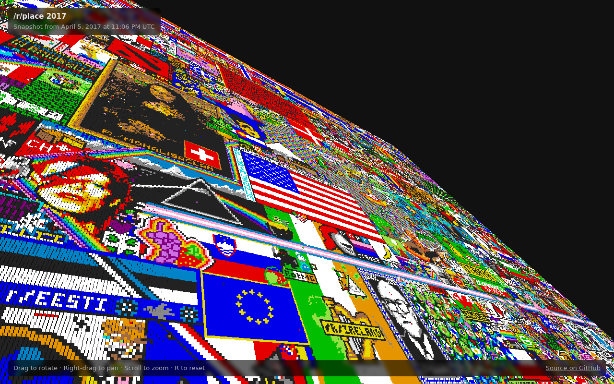

# /r/place three.js viewer

[](https://github.com/cillierscharl/place-three-viewer-js/actions/workflows/ci.yml)
[](LICENSE)
[](https://threejs.org/)

The final 2017 [/r/place](https://www.reddit.com/r/place/) canvas as a million-point three.js cloud you can spin, pan and zoom.

**[Open the viewer](https://cillierscharl.github.io/place-three-viewer-js/)**



## Controls

| Mouse | Touch | Action |
| --- | --- | --- |
| Left drag | One-finger drag | Rotate |
| Right drag | Two-finger drag | Pan |
| Scroll | Pinch | Zoom |
| <kbd>R</kbd> | | Reset the view |

## Running locally

Requires Node.js 22.12 or newer.

```bash
npm install
npm run dev
```

Open the URL Vite prints (http://localhost:5173 by default).

| Command | What it does |
| --- | --- |
| `npm run dev` | Dev server with hot reload |
| `npm test` | Unit tests (Vitest) |
| `npm run build` | Typecheck and build the static site into `dist/` |
| `npm run preview` | Serve the built `dist/` |

## How it works

[`public/place.bmp`](public/place.bmp) is the raw board reddit served from `/api/place/board-bitmap` on 5 April 2017, after the event ended. It's not a real BMP:

- 4 bytes: little-endian Unix timestamp of the snapshot
- 500,000 bytes: 1000×1000 pixels, two per byte (left pixel in the high nibble), each an index into the 16-colour palette

[`src/place.ts`](src/place.ts) decodes it, [`src/pointcloud.ts`](src/pointcloud.ts) turns each pixel into a coloured point, and [`src/main.ts`](src/main.ts) renders them with `THREE.Points` and `TrackballControls`. The point size is matched to the camera's field of view, so viewed face-on the points tile seamlessly like pixels at any zoom level.

## Deployment

Every push to `master` builds the site and publishes it to GitHub Pages (see [`.github/workflows/pages.yml`](.github/workflows/pages.yml)). The build uses relative paths, so `dist/` also works from any static host or sub-path.

## History

Built in April 2017, right after r/place ended, as a Visual Studio 2017 TypeScript project with RequireJS, gulp 3 and a vendored copy of three.js. It quietly stopped working once three.js dropped `THREE.Geometry`, and the azurewebsites demo went with it. In 2026 it was brought back from the dead for fun and posterity: same snapshot, same idea, modern tooling.

## License

[MIT](LICENSE)
